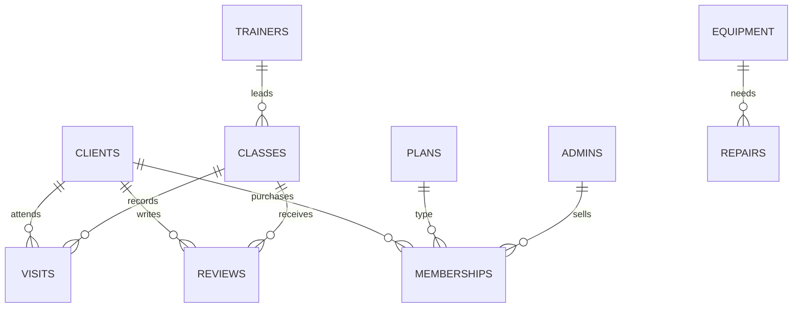

# База данных фитнес-клуба

Учебный проект по базам данных на **PostgreSQL**. База хранит информацию о клиентах, абонементах, групповых занятиях, посещениях, отзывах и ремонте оборудования.

В проекте использованы связи между таблицами, составные первичные ключи, ограничения `CHECK` и `UNIQUE`, функции и триггеры на PL/pgSQL. Все данные демонстрационные: имена, телефоны и другие сведения вымышлены.

## Структура базы

| Таблица | Что хранит |
|---|---|
| Клиенты | Клиенты и дата регистрации |
| Абонементы | Виды абонементов, стоимость и число занятий |
| Клиенты_Абонементы | Покупки, активация, статус и остаток занятий |
| Администраторы | Сотрудники, оформляющие покупки |
| Тренеры | Тренеры и специализации |
| Групповые_занятия | Расписание и вместимость занятий |
| Посещения | Посещения клиентов и отметки тренера |
| Отзывы_клиентов | Оценки и отзывы о занятиях |
| Оборудование | Оборудование клуба и его состояние |
| Ремонт_оборудования | История ремонтов и затраты |



На схеме: CLIENTS — клиенты, MEMBERSHIPS — купленные абонементы, PLANS — виды абонементов, ADMINS — администраторы, TRAINERS — тренеры, CLASSES — занятия, VISITS — посещения, REVIEWS — отзывы, EQUIPMENT — оборудование, REPAIRS — ремонты.

## Что делают триггеры

- Активируют абонемент при первом посещении.
- Списывают занятие при отметке «посетил» или «опоздал».
- Обновляют статус абонемента при покупке и изменении остатка или даты активации.
- Проверяют наличие посещения перед добавлением отзыва.

В дампе 10 таблиц, 6 функций и 4 триггера. Две функции сохранены в исходнике, но не подключены к триггерам. Представлений и оконных запросов в предоставленном дампе нет.

## Файлы

```text
source/original_pg17_dump.sql   исходный дамп без изменений
sql/01_restore.sql             восстановление в пустую базу
sql/02_function_fixes.sql      исправления функций
sql/03_queries.sql             примеры запросов к этой схеме
tests/smoke.sql                проверка основных операций
docs/changes.md                изменения и ограничения
docs/provenance.json           контрольная сумма исходника
```

Основой служит предоставленный дамп PostgreSQL 17.8. Ранее найденная SQLite-база в этот репозиторий не включена. Файлы запуска, исправления и примеры запросов подготовлены при оформлении проекта; исходный дамп сохранён отдельно.

## Как запустить

Нужны PostgreSQL **17.8** и утилиты `createdb`/`psql`. Python и дополнительные библиотеки не требуются. Команды выполняются из папки репозитория; имя пользователя замените на своё, если оно отличается от `postgres`.

```bash
createdb -h localhost -U postgres -E UTF8 fitness_club_demo
psql -X -h localhost -U postgres -d fitness_club_demo -v ON_ERROR_STOP=1 -1 -f sql/01_restore.sql
psql -X -h localhost -U postgres -d fitness_club_demo -v ON_ERROR_STOP=1 -1 -f sql/02_function_fixes.sql
psql -X -h localhost -U postgres -d fitness_club_demo -v ON_ERROR_STOP=1 -f sql/03_queries.sql
```

В Windows утилиты обычно находятся в `C:\Program Files\PostgreSQL\17\bin`. Если они не добавлены в PATH, в PowerShell используйте полный путь, например `& 'C:\Program Files\PostgreSQL\17\bin\psql.exe'` с теми же параметрами. Для UTF-8 можно задать `$env:PGCLIENTENCODING='UTF8'`.

`01_restore.sql` запускается один раз в **новой пустой базе**. Повторный запуск в заполненную базу завершится ошибкой. Параметры `-1` и `ON_ERROR_STOP=1` позволяют откатить восстановление при ошибке.

**Не запускайте исходный файл из `source/` в рабочем окружении:** он содержит `DROP DATABASE fit_club`. В `01_restore.sql` удалены удаление/создание базы, переключение подключения, привязка к Windows-локали и владельцу `postgres`.

## Проверка

После восстановления и исправлений, только в демонстрационной базе:

```bash
psql -X -h localhost -U postgres -d fitness_club_demo -v ON_ERROR_STOP=1 -f tests/smoke.sql
```

Проверяются структура, покупка, активация, списание занятий, неявка, запрет повторного посещения, отзывы и ограничения. Тестовые изменения выполняются внутри транзакции и откатываются через `ROLLBACK`.

Восстановление и эти проверки выполнены на PostgreSQL 17.8 под Windows 26 ноября 2026 года в отдельной тестовой базе.

## Ограничения

Это учебная база, а не готовая система для действующего клуба. Состояния абонементов сохранены на момент выгрузки в мае 2026 года; срок действия в функциях сравнивается с `CURRENT_DATE`. Поэтому старые записи нельзя использовать как текущий список действующих абонементов без дополнительной проверки дат.

Редактирование и удаление посещений не возвращают списанные занятия. Параллельные записи, контроль вместимости и автоматическое обновление статусов по расписанию не реализованы. Другие замечания и исправления описаны в [docs/changes.md](docs/changes.md).
